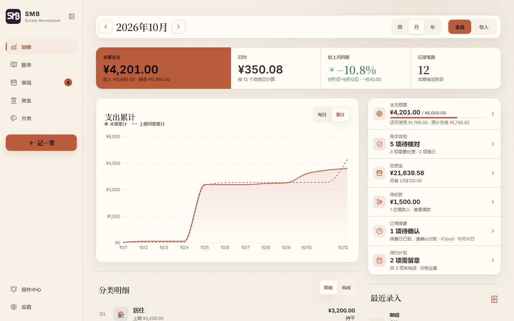
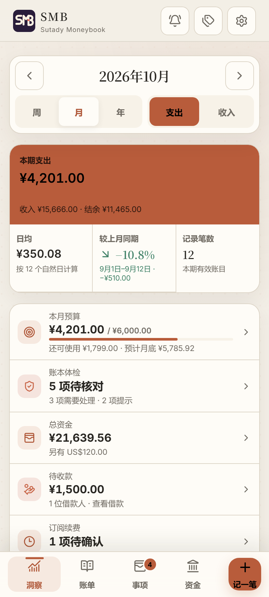
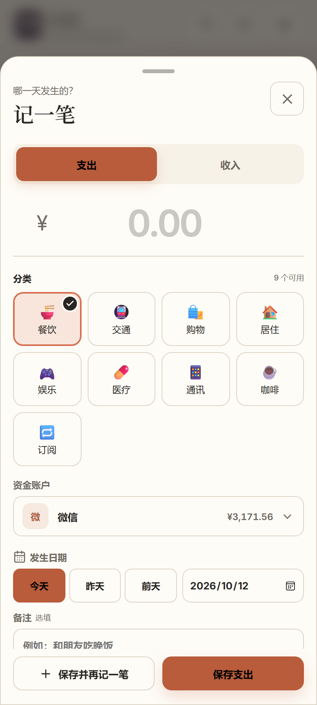
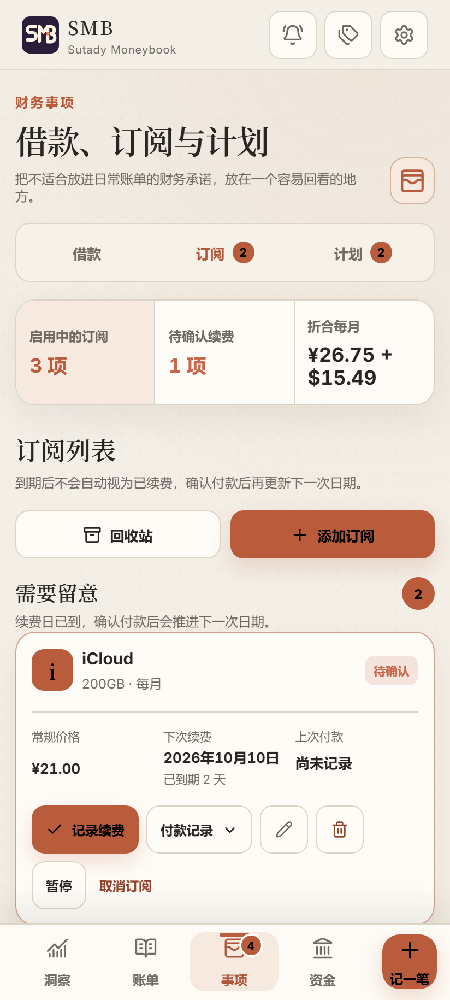
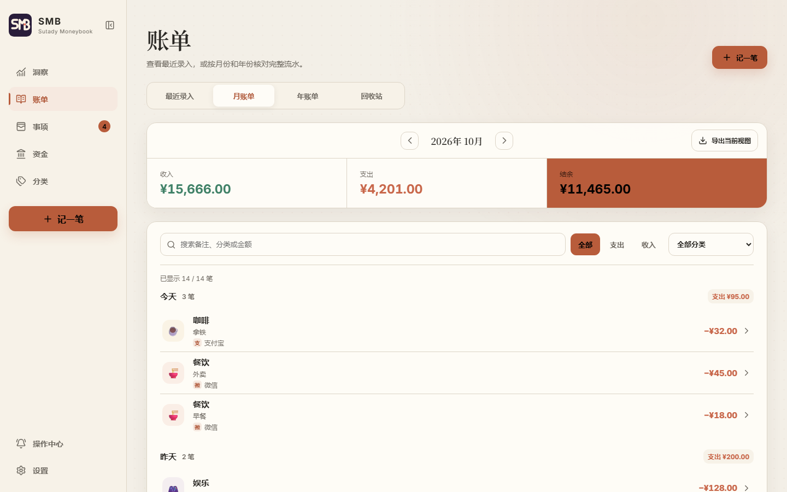
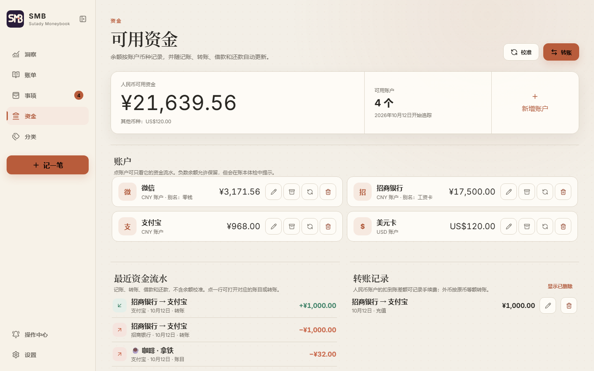
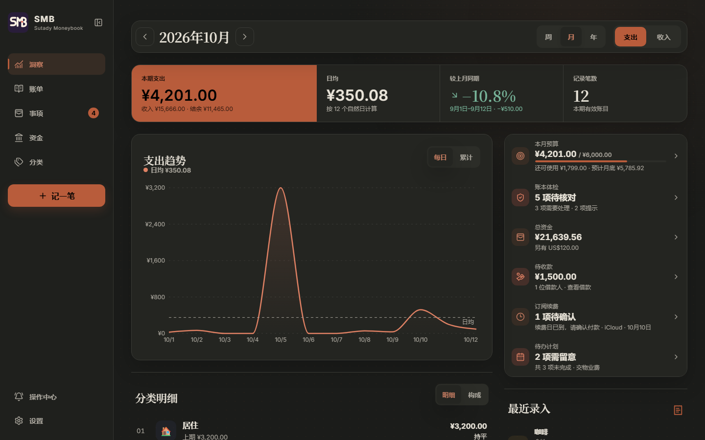

<div align="center">


# SMB — Sutady Moneybook

**一本只属于你的私人账本。** 数据只存在你自己电脑上的 SQLite 里，电脑和手机都能用；<br>
需要时，还可以让接入的 AI 助手（OpenClaw）通过 MCP 帮你记账、查账、提醒续费。

`React 19` · `Node.js 22` · `SQLite (WAL)` · `PWA` · `MCP` · `Cloudflare Tunnel（可选）`

</div>



<table>
  <tr>
    <td width="33%"></td>
    <td width="33%"></td>
    <td width="33%"></td>
  </tr>
  <tr>
    <td align="center">洞察：收支、结余、预算和事项一屏看完</td>
    <td align="center">记一笔：可连续补账，日期一行选完</td>
    <td align="center">订阅：即将续费与待确认分开，折合每月花费</td>
  </tr>
</table>

> 截图全部来自演示数据，不含任何真实账目。当前版本以 `package.json` 为准，更新内容见 [CHANGELOG](CHANGELOG.md)。

## 它能做什么

| 模块 | 你能用它做的事 |
| --- | --- |
| **记账与账单** | 快速记收入/支出，只记发生日期，金额以整数“分”保存；可「保存并再记一笔」连续补账。账单分“最近录入 / 月账单 / 年账单 / 回收站”，搜索支持备注、分类名和金额，还能搜全部时间；删除先进 30 天回收站，可撤销。 |
| **洞察** | 周、月、年的支出或收入，同时给出结余；进行中的月份只和上月同一段日期比较（例如 10 月 1–12 日对 9 月 1–12 日）。趋势图可切换「每日 / 累计」，累计视图叠加上期同期虚线。分类明细与构成图都能下钻到账单。 |
| **预算与体检** | 每月总预算和分类预算只提醒、不拦截。房租这类标为“固定支出”的分类按实际计入月底预测，不会月初就报超支。账本体检用确定性规则找出疑似重复、大额支出、预算风险、待确认续费和到期计划，核对后不会自动改账。 |
| **资金账户（可选）** | 记录微信、支付宝、银行卡等账户的真实余额，支持人民币、美元和 USDT。转账、手续费、余额校准和全额退款都有追加式流水；每条流水写明来源，可按账户筛选。启用前的旧账不会被追溯。 |
| **事项** | 借给别人的钱（分次还款、自动结清）、订阅（首期优惠、月/年/自定义周期、到期确认、取消可撤销）、一次性计划（预购尾款等，完成时才入账）。事项默认不计入消费统计，只有主动关联的账目才会。 |
| **AI 助手（可选）** | 标准 Streamable HTTP MCP，七十多个工具，只读工具带安全标注。可在“确认模式”（写账先提交待确认提案）和“直接接管”（立即执行，30 天内可撤销）之间切换；SMB 自己不调用任何外部模型。 |
| **备份与安全** | WAL + `synchronous=FULL`，迁移前自动快照；每日快照经完整性和外键检查后，可用 `age` 加密上传到你自己的 Google Drive。远程访问走 Cloudflare Access 双层保护。 |
| **外观** | 温暖纸张、墨夜和跟随系统三种主题，四种内置背景，或者只存在当前设备上的个人图片。手机和电脑共用一套界面，可安装为 PWA，支持“记一笔”桌面快捷方式。 |

<details>
<summary><b>更多截图：账单、资金和墨夜主题</b></summary>

<br>







</details>

## 快速开始

需要 **Node.js 22 或更高版本**。只在自己电脑上记账时，不需要配置任何外部服务。

**Windows：双击启动（推荐）**

双击项目根目录的 **`打开 SMB.cmd`**。第一次运行会自动安装依赖、根据模板生成 `.env`、构建程序，然后打开 `http://127.0.0.1:8788`（本机免登录模式）。保留标题为“SMB Service”的窗口；关掉它就是停止服务。

**任意系统：命令行**

```bash
npm install
cp .env.example .env
npm run build
npm start          # 打开 http://127.0.0.1:8788
```

开发时用 `npm run dev`（Vite 在 `http://127.0.0.1:5173`）。注意：开发服务器与正式服务读取同一个 `.env`，也就是同一个数据库和端口；在已部署的机器上开发前，请先看 [CLAUDE.md](CLAUDE.md) 的说明。

## 进阶功能

这些都是可选的，按需配置：

- **手机外网访问**：通过 Cloudflare Tunnel 免公网 IP 访问，Cloudflare Access 限定只有你的邮箱能登录。见 [部署指南](docs/DEPLOYMENT.md)。
- **接入 OpenClaw**：用 MCP 让 AI 助手记账、查询和每日提醒（只在有待办时提醒，只发数量不发金额）。见 [部署指南 · OpenClaw](docs/DEPLOYMENT.md)。
- **加密云备份**：双击 `配置Google Drive授权.cmd`，用你自己的 Google OAuth 客户端和 `age` 公钥，每天加密上传快照；本地快照可以放在另一块硬盘。见 [恢复指南](docs/RECOVERY.md)。
- **资金账户**：账户、转账、校准、退款和缺少账户核对。见 [资金追踪指南](docs/FUNDS.md)。
- **借款、订阅与计划**：见 [事项使用指南](docs/MATTERS.md)。

## 几条设计原则

- **SQLite 是唯一的真相。** 浏览器只保存外观、筛选位置和设备上的个人图片，从不保存账目副本或未保存的金额、备注。
- **“今天”以账本时区为准。** 电脑和手机所在时区不同时，“今天”、默认月份和周期边界仍然一致。
- **余额只靠追加流水计算。** 没有可以直接改的余额字段；修改、删除、恢复、退款都追加差额流水。
- **事项与账本互不干扰。** 借款、订阅和计划只有在你主动关联时才会影响统计，关联之后两边也不会自动同步。
- **不猜数字。** 外币账户必须填实际扣款金额，不查也不猜汇率；AI 批量记账也不会补全缺失的金额、日期或分类。

## 日常使用小贴士

- 页面打开时每 30 秒同步一次，切回窗口或恢复网络时立即同步。PWA 每分钟检查前端更新，没有正在编辑的表单时自动更新。
- Cloudflare 登录过期时，用页面上的「重新登录」，不要清除网站数据，否则当前设备上的个人背景图片会一起被删除。
- 洞察的期间、周/月/年、收支和趋势模式都保存在网址里；从分类下钻到账单后点「返回洞察」能回到原来的位置。
- 账单网址保持兼容：`/bills` 是最近录入，`?view=ledger&period=month&anchor=…` 是月账单，`period=year` 是年账单，`?view=trash` 是回收站。
- 「导出当前视图」下载当前筛选的 CSV；设置页可导出完整 JSON 和全部账目 CSV，事项另有借款、订阅、计划 CSV。

## 开发与质量检查

```bash
npm test             # Vitest：金额、时区、资金、事项、MCP、界面与可访问性
npm run typecheck    # 浏览器与服务端两套 TypeScript 检查
npm run build        # 字体 → 类型检查 → Vite 构建 → esbuild 打包服务端
```

正式更新前先做一份经过完整性检查的快照，并验证能恢复：

```powershell
npm.cmd run backup:snapshot -- manual-update
npm.cmd run backup:verify-restore
```

| 目录 | 内容 |
| --- | --- |
| `src/` | React PWA（页面、组件、样式），手机和电脑共用 |
| `server/` | Express API、MCP、资金、事项、预算、体检、备份与 OpenClaw 提醒 |
| `shared/` | API、MCP 和前端共用的 Zod 校验与类型 |
| `db/` | SQLite 迁移（当前版本 12） |
| `tests/` | 每个测试都使用独立的临时数据库，不会碰正式账本 |
| `scripts/` | 启动、自启动、快照、恢复和授权脚本 |
| `deploy/` | Cloudflare 与 OpenClaw 的无密钥配置模板 |

代码约定、领域规则和安全约束见 [AGENTS.md](AGENTS.md)。版本号只在 `package.json` 中维护：修复递增补丁版本，向后兼容的新功能递增次版本。Logo 规范见 [品牌指南](docs/BRAND.md)，暂缓的方向（账单导入、余额同步等）见 [ROADMAP](ROADMAP.md)。

`.env`、正式数据库、备份、日志和构建产物都不进入版本控制。
